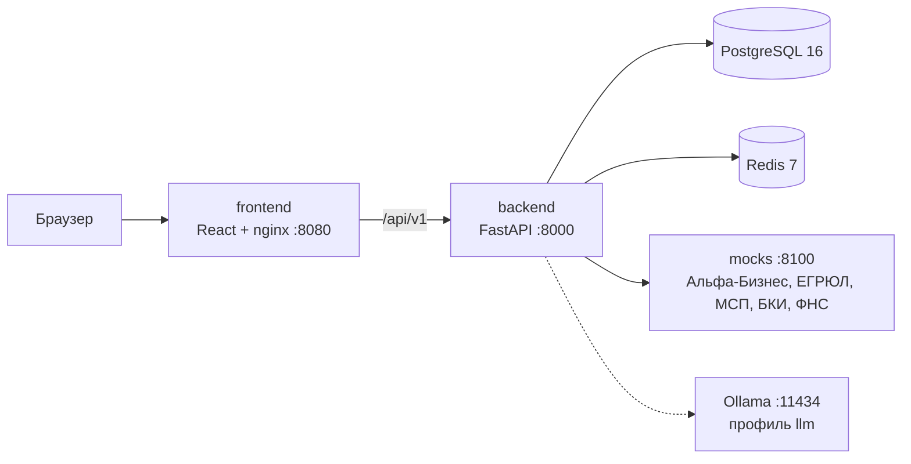

# BlokTea: умный кредитный кабинет предпринимателя

Прототип цифрового кредитного конвейера для малого и микробизнеса (кейс Альфа-Банка, «Альфа-Будущее»). Клиентский путь и обработка заявки банком собраны в одном продукте: предприниматель подбирает кредит под задачу, подаёт заявку и видит её статус, система проверяет данные по внешним источникам и считает скоринг, аналитик принимает решение, клиент подписывает договор и получает кредит с графиком платежей. Весь сценарий проходит внутри кабинета, без почты, SMS и звонков.

**Версия для проверки:** тег `v1.0`, коммит `ХЕШ_КОММИТА`.

## Что умеет

**Клиент** (веб-кабинет, 6 ролей сотрудников компании)
- онбординг: реквизиты из ЕГРЮЛ/ЕГРИП, финансы из Альфа-Бизнеса без ручного ввода;
- подбор кредита по задаче за 4 шага: до 3 вариантов с платежом, долговой нагрузкой и объяснением, предупреждение о нагрузке;
- заявка с автозаполнением, автосохранением и чек-листом документов; согласия подписываются кодом в кабинете;
- карточка заявки с таймлайном, задачи «требуется ваше действие», передача задачи коллеге, уведомления;
- ответ на запрос банка: файл или выписка из Альфа-Бизнеса в один клик;
- решение с объяснением: одобрение, «вы просили / банк предлагает» или отказ с советами;
- подписание по правилам компании (например, договор и поручительство разными людьми), выдача и график;
- персональная лента: программы поддержки и советы под форму бизнеса, отрасль и сезонность, с причиной показа.

**Банк**
- автопроверки: реестр, БКИ, обороты, ФНС, долговая нагрузка; балльный скоринг и стоп-факторы;
- авторешение для простых случаев, остальное в очередь аналитика с приоритетом;
- карточка аналитика, ИИ-резюме, звонки, варианты контрпредложения, решение в один экран;
- показатели процесса и настройка порогов скоринга без перезапуска.

**ИИ** (опционально, модель с открытыми весами Qwen3.5 9B через Ollama): распознаёт тип и поля документа, находит несовпадения, пишет понятные тексты решений и резюме. Решение и все числа считает код; при сбое модели работают шаблоны.

## Архитектура



Подробно: [docs/diagrams/architecture.md](docs/diagrams/architecture.md).

| Компонент | Технологии |
|---|---|
| Фронтенд | React 18, TypeScript (strict), Vite, TanStack Query, Core Design System Альфа-Банка (`@alfalab/core-components`) |
| Бэкенд | Python 3.12, FastAPI, SQLAlchemy 2 (async), Alembic, Pydantic 2, JWT + refresh-токены в HttpOnly cookie, argon2 |
| Данные | PostgreSQL 16 (заявки, решения, аудит), Redis 7 (refresh-сессии, rate limit, идемпотентность) |
| Внешние системы | отдельный сервис моков с синтетическими данными |
| ИИ | Ollama, Qwen3.5 9B (Apache-2.0), Tesseract OCR как запасной путь |

## Требования

- Docker Desktop 4.26+ или Docker Engine с Compose v2.24+;
- без ИИ: 2 ядра, 4 ГБ RAM, 3 ГБ на диске;
- с ИИ (профиль `llm`): 16 ГБ RAM, ещё 7 ГБ на модель; GPU не обязательна, но на CPU ответы модели занимают 30-100 с ([docs/llm.md](docs/llm.md));
- свободные порты 8080, 8000, 8100, 5432, 6379 (и 11434 для `llm`).

## Запуск

```bash
git clone https://github.com/rayn1xx/BlokTea.git
cd BlokTea
cp .env.example .env        # можно не копировать: значения по умолчанию подходят для демо
docker compose up --build   # или make up
```

Откройте http://localhost:8080. При первом старте бэкенд применяет миграции и создаёт демо-данные.

С ИИ: в `.env` поставьте `LLM_ENABLED=true` и запустите `docker compose --profile llm up --build` (или `make up-llm`). Сервис `ollama-init` один раз скачает модель (~6,6 ГБ).

| Команда | Что делает |
|---|---|
| `make reset-demo` | вернуть демо-данные к исходному состоянию (перед каждым показом) |
| `make down` | остановить всё, включая профиль `llm` |
| `make test` | тесты бэкенда |
| `make openapi` | перегенерировать `docs/openapi.yaml` |
| `make lock` | пересобрать `backend/requirements.lock` |

| Адрес | Что там |
|---|---|
| http://localhost:8080 | веб-кабинет клиента и аналитика |
| http://localhost:8000/docs | Swagger UI |
| http://localhost:8000/api/v1/health | состояние БД, моков и LLM |

## Демо-учётки

Пароль у всех: `alfa2026`. Код подтверждения (согласия, подпись) показывается рядом с полем ввода: так работает `DEMO_MODE=true` вместо SMS.

| Почта | Кто | Зачем |
|---|---|---|
| `petr.smirnov@test.local` | Смирнов П. И., собственник и директор ООО «Машпромхоз» (производство) | основной клиент: подбор, заявка, принятие решения, подпись договора |
| `sergey.petrov@test.local` | Петров С. А., второй собственник | подпись договора поручительства |
| `anna.malkina@test.local` | Малькина А. В., бухгалтер | ответ на запрос банка, главная бухгалтера |
| `irina.les@test.local` | Лес И. О., сотрудник по финансированию | подаёт заявки, но не принимает решения |
| `maria.orlova@test.local` | ИП Орлова М. С. (пекарня) | второй клиент: другая лента, каталог, одна подпись |
| `analyst@test.local` | Кузнецова Е. П., кредитный аналитик | очередь, решение по заявке |
| `bank.admin@test.local` | Захаров О. И., администратор банка | пороги скоринга, показатели |
| `no.role@test.local` | сотрудник без роли в компании | экран «Нет доступа» |

Код приглашения нового сотрудника: `4821-KX`.

## Сценарий проверки (10 минут)

1. **Клиент.** Войдите как `petr.smirnov@test.local`, подтвердите данные компании. На главной откройте ленту: каждая новость объясняет, почему показана.
2. **Подбор.** «Персональный подбор»: пополнение оборотных средств, 2 000 000 ₽, 24 мес. Подтвердите финансы. Система рекомендует 1 500 000 ₽ на 36 мес. (нагрузка 26,2%) и объясняет почему.
3. **Заявка.** Нажмите «Оставить 2 000 000 ₽», подпишите согласия кодом, отправьте. Через несколько секунд заявка «На рассмотрении»: балл 62, нагрузка 33,1%.
4. **Банк.** Войдите как `analyst@test.local`, возьмите заявку из очереди: проверки, скоринг по факторам, рекомендация «другие условия». Решение: «Другие условия», 1 500 000 ₽ на 36 мес.
5. **Решение.** Снова `petr.smirnov@test.local`: «Вы просили / банк предлагает», объяснение. «Принять», подписать кредитный договор.
6. **Второй подписант.** `sergey.petrov@test.local` подписывает поручительство. Кредит выдан, открывается график платежей.
7. **Лента под клиента.** Войдите как `maria.orlova@test.local`: лента другая (общепит, ИП на патенте), производственных программ нет.

Ещё сценарии (авторешение, запрос документов с передачей бухгалтеру, отказ, недоступный источник, ИИ): [docs/test-scenarios/README.md](docs/test-scenarios/README.md).

## Переменные окружения

Все переменные с комментариями: [.env.example](.env.example). Основные:

| Переменная | По умолчанию | Назначение |
|---|---|---|
| `JWT_SECRET` | `local-dev-secret-change-me` | секрет подписи токенов; для стенда сгенерировать: `python -c "import secrets; print(secrets.token_urlsafe(48))"` |
| `DEMO_MODE` | `true` | показывать код подтверждения в ответе и в интерфейсе |
| `SEED_DEMO` | `true` | создать демо-данные при первом старте |
| `LLM_ENABLED` | `false` | включить ИИ (нужен профиль `llm`) |
| `LLM_MODEL_TEXT`, `LLM_MODEL_VISION` | `qwen3.5:9b` | модели Ollama |
| `LLM_TIMEOUT_MS` | `30000` | таймаут модели, после него шаблонный текст |
| `MOCKS_DOWN` | пусто | выключить внешние системы в моках, например `bki,fns` |
| `RATE_PERCENT_DEFAULT`, `LOAD_THRESHOLD_PERCENT`, `LOAD_TARGET_PERCENT` | `15`, `30`, `26.5` | допущения кредитной логики |
| `POSTGRES_*`, `REDIS_*` | `bloktea`, порты 5432/6379 | подключение к БД и Redis |
| `REFRESH_COOKIE_SECURE` | `false` | `true` на стенде с HTTPS |
| `FRONTEND_PORT`, `OLLAMA_PORT` | `8080`, `11434` | порты на хосте |

## Надёжность и безопасность

- **Сбой источника не ломает процесс:** проверка получает статус «ошибка», заявка уходит аналитику, проверку можно повторить; моки умеют «падать» по `MOCKS_DOWN`.
- **ИИ не влияет на решение:** числа из ответа модели сверяются со входом, при расхождении или таймауте используется шаблон.
- **Целостность заявки:** переходы статусов только по state machine (`409` на недопустимый), оптимистичная блокировка черновика (`version`), идемпотентные `POST` по `Idempotency-Key`, полный журнал событий и аудит.
- **Доступ:** короткий access-токен, ротация refresh-токенов с отзывом при повторном использовании, права по роли и правилам подписи компании, rate limit на вход и коды, пароли в argon2, персональные данные (ФИО, паспорта, счета) не уходят в модель.
- **Воспроизводимость:** версии образов закреплены, Python-зависимости в `backend/requirements.lock`, npm в `frontend/package-lock.json`; миграции применяются при старте, healthcheck у каждого сервиса.

## Документация

| Документ | Что внутри |
|---|---|
| [docs/features.md](docs/features.md) | подробная роспись всех функций клиента и банка: правила, роли, экраны, ручки |
| [docs/credit-process.md](docs/credit-process.md) | модель кредитного процесса: границы, этапы, роли, данные, результаты; что вошло в MVP и почему |
| [docs/Бизнес_аналитика_фич.md](docs/Бизнес_аналитика_фич.md) | исследование: 35 функций с источниками, разбор 45 отзывов клиентов |
| [docs/scoring-decision.md](docs/scoring-decision.md) | скоринг, нагрузка, авторешение, подбор: формулы и пороги |
| [docs/diagrams/architecture.md](docs/diagrams/architecture.md) | архитектурная схема и слои бэкенда |
| [docs/diagrams/application-states.md](docs/diagrams/application-states.md) | диаграмма состояний заявки |
| [docs/diagrams/data-model.md](docs/diagrams/data-model.md) | модель данных (ER) |
| [docs/api.md](docs/api.md) | описание API, общие правила, ошибки |
| [docs/openapi.yaml](docs/openapi.yaml) | OpenAPI 3.1 |
| [docs/postman/BlokTea.postman_collection.json](docs/postman/BlokTea.postman_collection.json) | коллекция запросов со сквозными сценариями |
| [docs/test-scenarios/README.md](docs/test-scenarios/README.md) | тестовые сценарии и автотесты |
| [docs/llm.md](docs/llm.md) | ИИ-задачи, модели, замеры скорости |
| [docs/frontend/README.md](docs/frontend/README.md) | фронтенд: структура, роуты, роли в интерфейсе |
| [THIRD_PARTY_NOTICES](THIRD_PARTY_NOTICES) | сторонние компоненты, модели, смоделированные интеграции |

## Тесты

```bash
cd backend && pytest -m unit          # 189 unit-тестов, без БД
docker compose up -d db redis && cd backend && pytest   # все: API, интеграционные, миграции
cd frontend && npm test               # 62 теста
```

CI: [.github/workflows/backend-tests.yml](.github/workflows/backend-tests.yml).

## Ограничения прототипа

- Внешние системы смоделированы, данные синтетические; подпись и выдача без реальных операций.
- Кредитная логика упрощена и описана явно ([docs/scoring-decision.md](docs/scoring-decision.md)).
- ИИ на CPU медленный: проверка документа занимает 2-4 минуты в фоне, сканы PDF без текстового слоя не распознаются.
