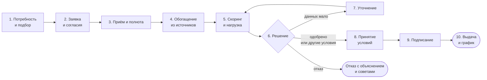

# Модель кредитного процесса и границы MVP

Документ отвечает на пункты 2 и 4 постановки задачи: границы процесса, этапы, участники, данные, возможные результаты и логика решения. Почему выбраны именно эти функции, показано в [Бизнес_аналитика_фич.md](Бизнес_аналитика_фич.md): 35 функций с источниками и разбором 45 отзывов клиентов.

## Границы

**Начало:** у бизнеса появилась потребность в деньгах (или банк показал предодобренное предложение).
**Конец:** кредит выдан и у клиента есть график платежей, либо заявка завершилась отказом или отзывом.

Вне границ: реальное перечисление денег, юридически значимая электронная подпись, оценка залога выездом, обслуживание кредита после выдачи (кроме просмотра графика), реструктуризация, взыскание.

## Участники

| Участник | Роли в системе | Что делает |
|---|---|---|
| Собственник, директор | `owner`, `director` | подаёт заявку, принимает условия, подписывает; собственник управляет командой и правилами подписи |
| Финансовый директор, бухгалтер | `cfo_or_accountant` | загружает документы, отвечает на запросы банка, подписывает по правилам компании |
| Сотрудник по финансированию, по банковским продуктам | `financing_employee`, `banking_employee` | готовит и подаёт заявку, загружает документы |
| Иной уполномоченный сотрудник | `authorized_employee` | загружает документы |
| Система | — | автопроверки по внешним источникам, скоринг, авторешение, задачи и уведомления |
| Кредитный аналитик | `underwriter` | очередь, разбор заявки, звонки, решение |
| Администратор банка | `bank_admin` | пороги скоринга и нагрузки, показатели процесса |

Шесть клиентских ролей взяты из кейса (стр. 5). Права по умолчанию: `backend/app/domain/catalog.py: DEFAULT_PERMISSIONS`, собственник может их менять.

## Этапы

| № | Этап | Кто | Данные на входе | Результат | Экраны / ручки |
|---|---|---|---|---|---|
| 1 | Потребность и подбор | клиент | цель, сумма, срок, срочность; финансы из Альфа-Бизнеса | до 3 вариантов продукта с платежом, нагрузкой и объяснением | S9-S12, `/matching-sessions/*`, каталог `/products` |
| 2 | Заявка и согласия | клиент | рекомендация или продукт из каталога, реквизиты из ЕГРЮЛ, документы из профиля | черновик с автосохранением, согласие на запрос в БКИ подписано кодом | S14, `/applications`, `/consents/*` |
| 3 | Приём и проверка полноты | система | заявка, чек-лист обязательных документов по продукту | `submitted`, недостающие документы превращаются в запрос | `POST /submit`, `review.py` |
| 4 | Обогащение | система | ИНН | реестр (действует ли), БКИ (просрочки), обороты (12 мес.), ФНС (налоговый долг) | `integrations/external.py` → моки |
| 5 | Скоринг и нагрузка | система | факты из этапа 4, параметры заявки | балл 0-100 по 5 факторам, стоп-факторы, долговая нагрузка | `domain/scoring.py`, `domain/finance.py` |
| 6 | Решение | система или аналитик | балл, проверки, нагрузка, ИИ-резюме | одобрение, контрпредложение, запрос информации или отказ | B1-B3, `/bank/applications/*` |
| 7 | Уточнение | клиент | вопрос аналитика, нужные типы документов | ответ с документами (файл или выписка из Альфа-Бизнеса) | S16, `/info-requests/*/respond` |
| 8 | Принятие условий | клиент с правом `accept_offers` | решение: «вы просили / банк предлагает» | `signing` или отзыв | S17, `/offer/accept`, `/offer/decline` |
| 9 | Подписание | подписанты по правилам компании | очередь подписантов (например, договор и поручительство) | все подписи собраны кодом в кабинете | S18, `/signing/*` |
| 10 | Выдача | система | одобренные условия | кредит, счёт зачисления, график платежей | S19, `/loans/*` |

Статусы и переходы: [diagrams/application-states.md](diagrams/application-states.md).

## Скоринг и кредитное решение

Скоринг и решение разделены, как рекомендует кейс (стр. 14-15). Скоринг даёт оценку риска, а решение учитывает ещё стоп-факторы, нагрузку и полноту данных.

1. **Скоринг**: балльная модель на 100 баллов. Факторы: срок бизнеса (20), кредитная история (20), долговая нагрузка (25), отрасль (15), стабильность оборотов (20).
2. **Стоп-факторы** дают отказ независимо от балла: компания не действует, текущая просрочка в БКИ, налоговый долг больше 10 000 ₽, бизнесу меньше 3 месяцев, расходы не меньше поступлений.
3. **Авторешение** после отправки:
   - источник не ответил → заявка уходит аналитику;
   - нет обязательного документа → запрос информации;
   - стоп-фактор или балл < 45 → отказ;
   - балл ≥ 70 без предупреждений → одобрение;
   - иначе в очередь аналитика с рекомендацией (55-69 «другие условия», 45-54 ручная проверка).
4. **Контрпредложение**: система перебирает суммы и сроки так, чтобы нагрузка не превышала целевую (26,5%), а балл был ≥ 70, и показывает аналитику до трёх вариантов.

Все пороги, формулы и контрольный пример: [scoring-decision.md](scoring-decision.md). Пороги меняет `bank_admin` без перезапуска (B4).

## Что вошло в MVP и почему

| Решение | Почему |
|---|---|
| Подбор по задаче, а не выбор из списка продуктов | 25% проблемных отзывов про непонятные условия; пользователь может не разбираться в продуктах (кейс, стр. 5) |
| Финансы берутся из Альфа-Бизнеса, а не вводятся вручную | меньше повторного ввода (кейс, стр. 4), данные для нагрузки достовернее |
| Предупреждение о нагрузке до отправки | клиент видит риск отказа заранее и может выбрать рекомендованные условия |
| Авторешение для простых случаев и очередь аналитика для остальных | банк обрабатывает много заявок; эксперт нужен только в нестандартных ситуациях (кейс, стр. 4) |
| Результат не бинарный: контрпредложение и запрос информации | прямо требуется кейсом (стр. 15) |
| Таймлайн заявки, задачи «требуется ваше действие», уведомления в кабинете | 19% проблемных отзывов про статус и сроки; сценарий целиком внутри продукта, без почты и SMS (ограничение 05) |
| Роли и правила подписи компании | заявку оформляют разные сотрудники (кейс, стр. 5) |
| ИИ только для документов и текстов | решение должно быть объяснимым и воспроизводимым; ИИ ускоряет проверку документов и пишет понятные объяснения (рекомендация 05) |

## Упрощения

Все допущения сохраняют смысл интеграций (ограничение 06):

- внешние системы (Альфа-Бизнес, ЕГРЮЛ/ЕГРИП, реестр МСП, БКИ, ФНС) заменены сервисом моков с синтетическими данными; контракты упрощены;
- подписание моделируется одноразовым кодом в кабинете, выдача создаёт запись о кредите без движения денег;
- ставка прототипа 15%, ставки продуктов из публичных данных (`SOURCE_NOTE` в каталоге);
- залог учитывается как признак в заявке, без оценки.

## Что дальше

- Распознавание сканов PDF без текстового слоя (сейчас ИИ читает текстовый слой PDF и изображения PNG/JPG).
- Подтверждение типа документа пользователем и история версий документа ([frontend/open-questions.md](frontend/open-questions.md)).
- Замена моков на реальные интеграции через тот же слой `integrations/external.py`.
- Статистическая модель скоринга вместо балльной после накопления истории решений.
