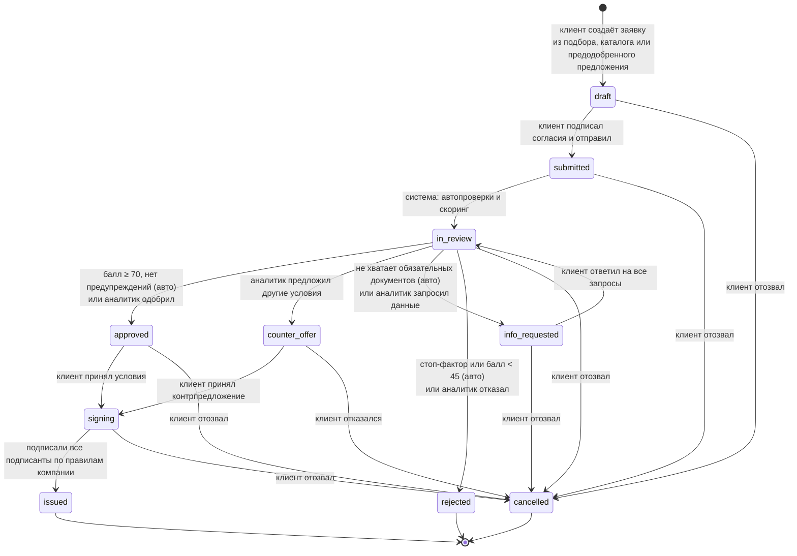

# Диаграмма состояний заявки

Источник правды: `backend/app/domain/state_machine.py`. Недопустимый переход возвращает `409 INVALID_TRANSITION`. Каждый переход пишется в `application_events` (лента событий заявки) и в `audit_log`.

## Группы статусов

| Группа | Статусы | Где видно |
|---|---|---|
| Черновики | `draft` | счётчик `drafts` на главной |
| В банке | `submitted`, `in_review`, `info_requested` | `in_bank`, очередь аналитика |
| Ждут подписания | `approved`, `counter_offer`, `signing` | `awaiting_signing` |
| Завершены | `issued`, `rejected`, `cancelled` | `finished` |

## Кто переводит

| Переход | Инициатор | Ручка |
|---|---|---|
| `draft → submitted` | клиент с правом `submit_applications` | `POST /applications/{id}/submit` |
| `submitted → in_review` и авторешение | система, фоновая задача после отправки | `services/review.py: auto_review` |
| `in_review → approved / counter_offer / info_requested / rejected` | аналитик (`underwriter`) | `POST /bank/applications/{id}/decision` |
| `info_requested → in_review` | клиент | `POST /applications/{id}/info-requests/{rid}/respond` |
| `approved / counter_offer → signing` | клиент с правом `accept_offers` | `POST /applications/{id}/offer/accept` |
| `counter_offer → cancelled` | клиент | `POST /applications/{id}/offer/decline` |
| `signing → issued` | последний подписант | `POST /applications/{id}/signing/confirm` |
| `* → cancelled` | клиент | `POST /applications/{id}/cancel` |

При переходе в `issued` создаётся кредит (`loans`) с графом платежей: выдача смоделирована без реальных операций.
