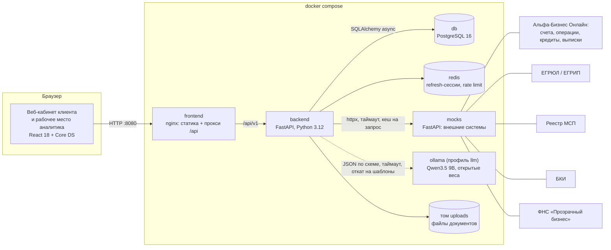
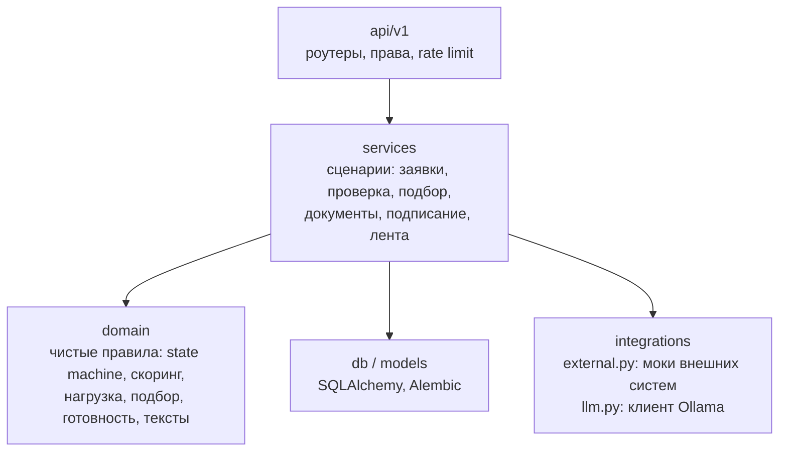

# Архитектурная схема

## Слои бэкенда

| Слой | Папка | Что делает |
|---|---|---|
| API | `backend/app/api/v1` | HTTP-контракты, авторизация (JWT access + refresh в HttpOnly cookie), проверка прав по роли, rate limit на вход и коды |
| Сервисы | `backend/app/services` | Сценарии конвейера: подача, автопроверки и авторешение (`review.py`), решение аналитика (`bank.py`), подписание, документы, лента |
| Домен | `backend/app/domain` | Правила без ввода-вывода: переходы статусов, скоринг, нагрузка, подбор продукта. Покрыты unit-тестами |
| Данные | `backend/app/models`, `backend/migrations` | PostgreSQL, миграции Alembic применяются при старте контейнера |
| Интеграции | `backend/app/integrations` | Клиент внешних систем (моки) и LLM. Сбой источника не роняет процесс: проверка получает статус `error`, заявка уходит аналитику |
| Моки | `backend/mocks` | Отдельный сервис с синтетическими данными. `MOCKS_DOWN=bki,fns` выключает системы для сценария «источник недоступен» |

## Где работает ИИ

LLM не принимает кредитное решение: баллы, суммы и статус считает код. Модель извлекает поля из документов и формулирует тексты для клиента и аналитика. Числа в ответе модели сверяются со входом, при расхождении, ошибке или таймауте используется шаблон. Подробно: [docs/llm.md](../llm.md).
