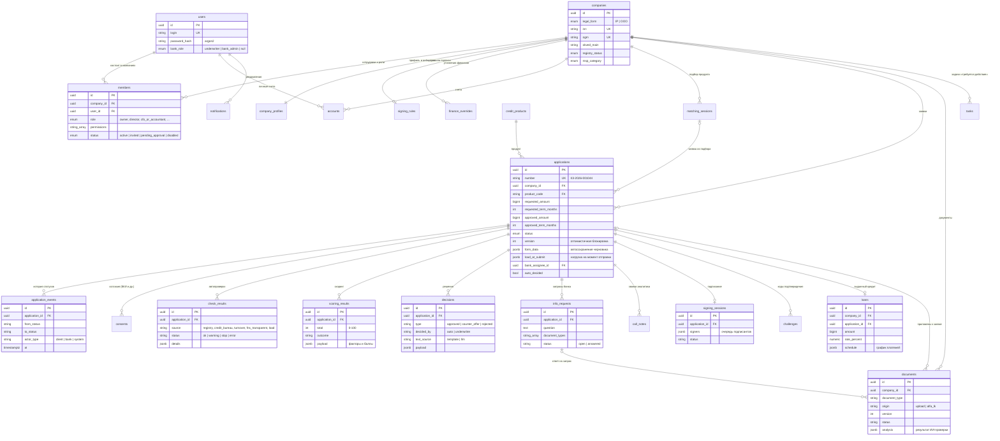

# Модель данных

PostgreSQL 16, схема создаётся миграциями Alembic (`backend/migrations/versions`). ORM-модели: `backend/app/models`. Деньги хранятся в копейках (`BIGINT`), в API передаются как `{ "value": <копейки>, "currency": "RUB" }`.

## Таблицы вне схемы

| Таблица | Назначение |
|---|---|
| `credit_products` | справочник продуктов: оборотный, инвестиционный, овердрафт, кредитная линия, экспресс, на любые цели, госпрограмма |
| `feed_items` | новости ленты с правилами показа в `targeting` (форма бизнеса, префиксы ОКВЭД, сезонность, готовность) |
| `settings` | пороги скоринга и нагрузки, меняет `bank_admin` |
| `audit_log` | журнал действий: кто, что, с какой сущностью |

Redis хранит refresh-сессии (ротация токенов, отзыв при повторном использовании) и счётчики rate limit.
